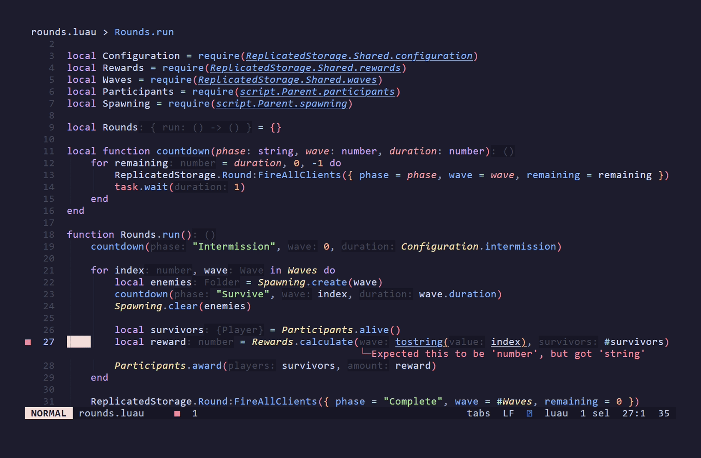

# Instar

Type checking, formatting, linting, and a language server for [Luau](https://luau.org/), with Roblox support.

## Why Instar?

**One Luau toolchain. Less setup.**

- **Check, lint, format, and edit with one executable.** Use the same tool locally, in CI, and through your editor's language-server client.
- **Your Roblox project is already configuration.** With Rojo on `PATH`, Instar discovers `*.project.json`, generates sourcemaps, and enables Roblox types automatically.
- **One project configuration for terminal and editor.** Share checking, linting, formatting, and module-resolution settings through `instar.toml`. Existing `.luaurc` and `.config.luau` settings work too.
- **Understand changes before applying them.** Get source-highlighted diagnostics, formatting previews, and explicit lint fixes.
- **Navigate the whole project.** Cross-module definitions and rename, automatic imports, type hints, and Roblox API documentation are available through the language server.

### See it work

Project-wide checking, Roblox linting, and formatting across a ten-module example:


<details>
<summary>Editor workflow in Mitos</summary>

Live diagnostics, cross-file navigation and rename, completion, and Roblox documentation:



</details>

## Install

Download an archive from [Releases](https://github.com/instar-luau/instar/releases), extract it, and put `instar` on your `PATH`.

Builds target macOS on Apple silicon and Intel, Linux x86-64 with glibc, and Windows x86-64.

## Usage

Run from your project directory, or pass a file or directory:

```sh
instar check
instar check src --watch
instar format --check
instar lint
```

`instar format` writes changes. Use `--preview` to see a diff first. Lint fixes require `--fix`:

```sh
instar format --preview
instar format
instar lint --fix
```

See `instar --help` or `instar <command> --help` for more options.

## Configuration

Add an `instar.toml` to your project. For example:

```toml
exclude = ["Packages/**"]

[check]
mode = "strict"

[format]
indent_style = "spaces"
width = 100
```

Instar also reads `.luaurc` and `.config.luau`. See the [configuration manual](configuration.md) for all project and LSP settings.

## Editor

Configure your editor's LSP client to run `instar server` for Luau files over standard input and output. Use your project root as the workspace directory.

## Acknowledgments

Thanks to these projects for their work on Luau tooling and the ideas Instar builds on:

- [luau-lsp](https://github.com/JohnnyMorganz/luau-lsp)
- [StyLua](https://github.com/JohnnyMorganz/StyLua)
- [Selene](https://github.com/Kampfkarren/selene)
- [Larvae](https://github.com/larvae-luau/larvae)

## License

[MIT](LICENSE).
